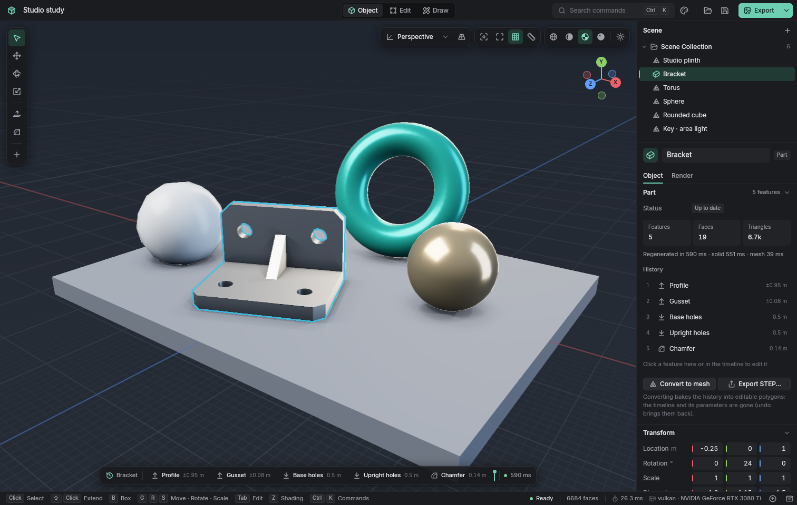
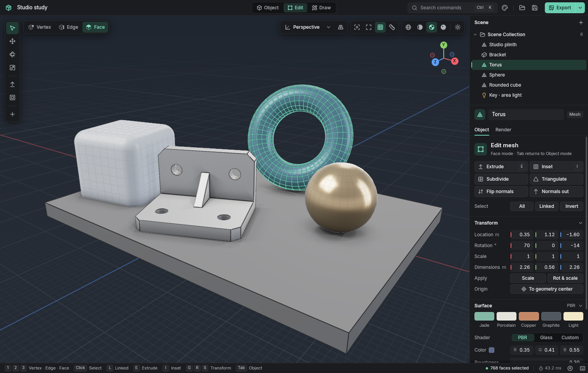
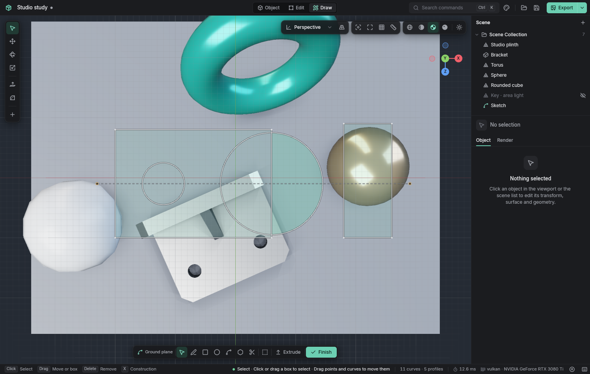
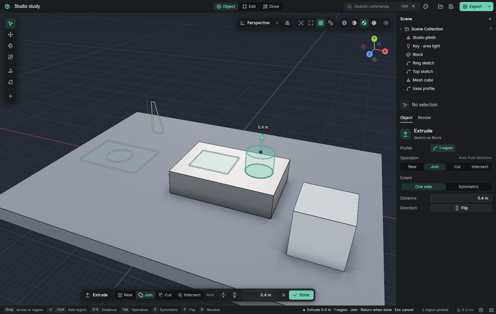
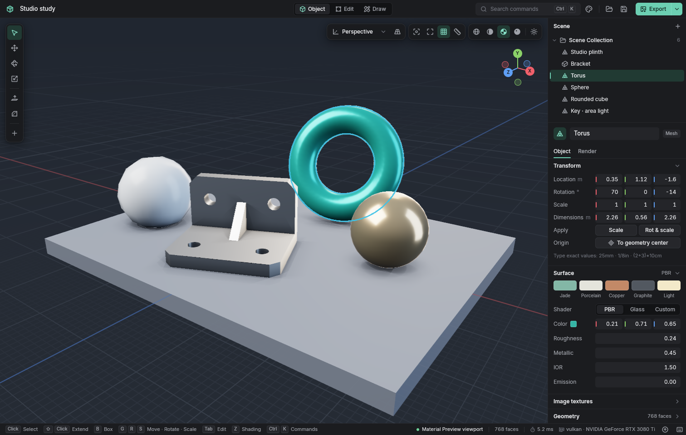
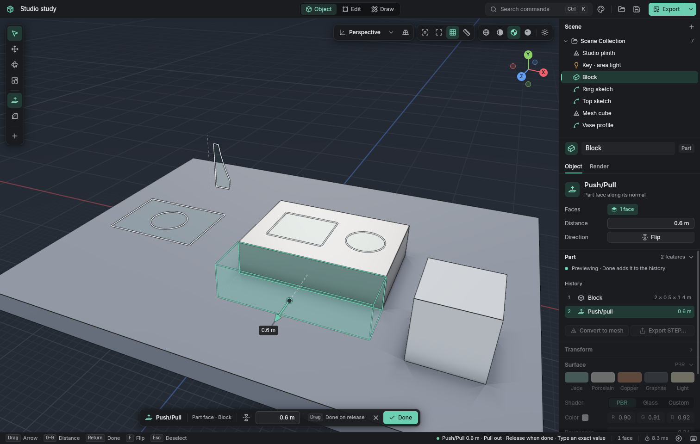
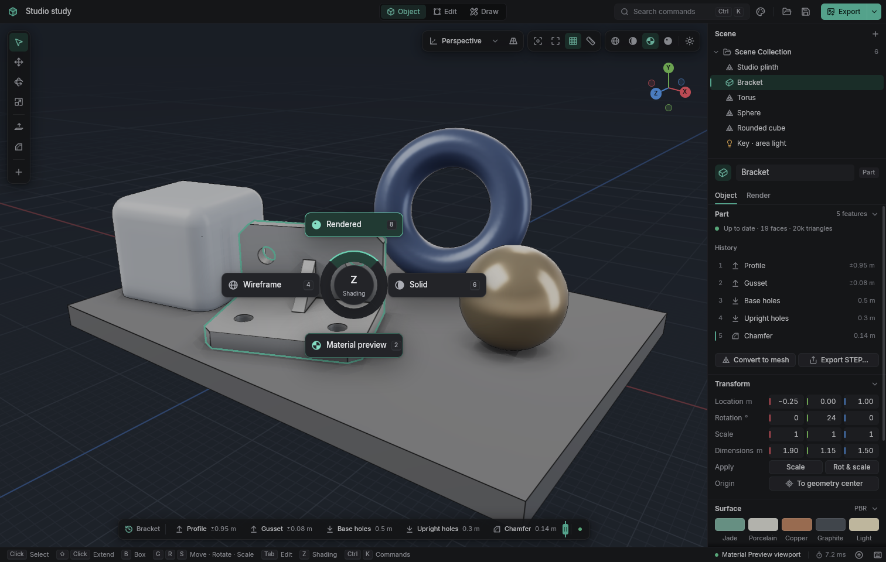
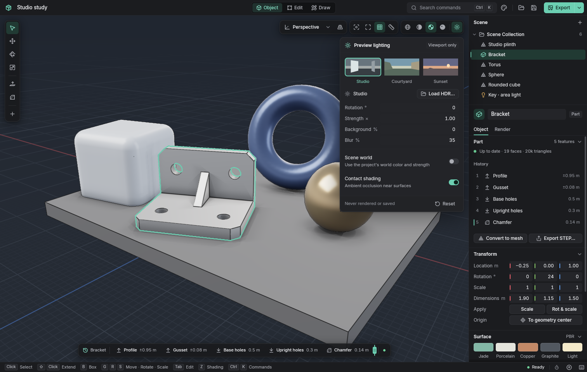
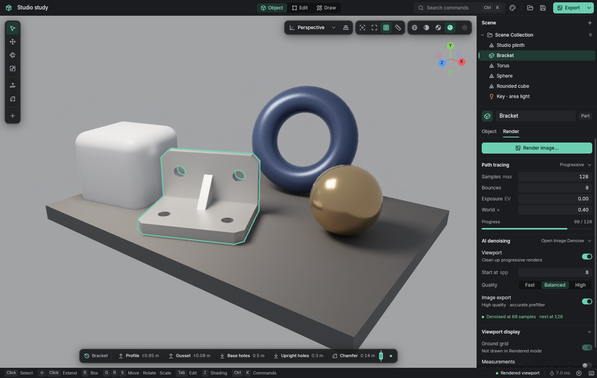
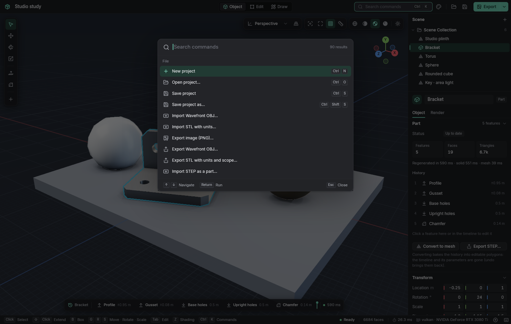

# Forma

Forma is a native 3D modeller where polygon meshes and parametric CAD parts live
in the same scene. Shape freeform objects with Blender-style mesh editing, build
precise parts from sketches with a Fusion-style feature timeline, or push and
pull faces directly — and move geometry between the two whenever the work calls
for it. It is written in Rust with a GPUI interface, a B-rep kernel on
[truck](https://github.com/ricosjp/truck) and a GPU path tracer (Metal or wgpu),
and runs on macOS, Windows and Linux.



Forma opens on a small studio: a torus, a copper sphere and a rounded cube are
polygon meshes; the machined bracket beside them is a CAD part with a real
history — an L profile sketched and extruded, a gusset, mounting holes cut from
sketches on two faces, and chamfered corners. The bracket starts selected, so
its timeline sits at the bottom of the viewport: click any step to change it and
the part regenerates. **New project** (`⌘N`) opens the same scene.

## Three ways to make geometry

| Mesh editing | Draw, then features | Direct modelling |
| --- | --- | --- |
|  |  |  |

**Mesh editing.** Polygon meshes with Object and Edit modes in the Blender
mould: vertex, edge and face selection; move, rotate and scale with axis and
plane constraints and typed expressions (`25mm`, `(2+3)*10cm`); extrude, inset,
Catmull–Clark subdivision, convex bevel, triangulation and normal repair; PBR,
glass and custom-shader materials. See [meshes and the workspace](#meshes-and-the-workspace).

**Draw, then features.** [Draw mode](#draw-mode) sketches exact 2D geometry on
the ground, a view plane or any flat face, with snapping, inference and typed
dimensions; closed regions become profiles. Extrude or revolve them into a
[part](#parts): every step becomes a feature on the part's
[timeline](#feature-timeline), its values stay editable in the inspector, and
the sketch stays linked, so editing it later updates the part.

**Direct modelling.** Point at a sketch region and press `E` to extrude it, or
`P` to push and pull a face of a part *or* a mesh. Join and Cut are inferred from
where the sketch lies; `Tab` on a part selects its B-rep faces and edges for
push/pull and chamfers; a small panel keeps the last operation adjustable. On a
part, each step still lands on the timeline as a feature. See
[direct modelling](#direct-modelling).

### Meshes and parts together

- **One scene.** Parts and meshes share the outliner, transforms, parenting,
  collections, materials, the four render modes, picking, measurements, undo
  and `.forma` files.
- **Convert either way.** **Convert to part** turns a closed, manifold mesh into
  a B-rep solid (flat polygons become faces; coplanar neighbours merge).
  **Convert to mesh** bakes a part into editable polygons (undo restores the
  history).
- **Booleans across types.** **Join**, **Cut** and **Intersect** combine any
  selected parts and meshes into the active object; meshes convert on the way,
  and each tool keeps its own history inside the new feature.
- **Push/pull on both.** On a part it adds a feature; on a mesh the polygon
  slides with its neighbours or extrudes.
- **Exchange.** STEP imports and exports parts as exact B-rep solids; OBJ and
  STL carry everything as triangles (part tessellations included); PNG exports
  the current render mode.

The kernel runs in a separate worker process, so a slow or crashing boolean
never freezes or takes down the editor. Its limits are listed honestly under
[limitations](#limitations).

## Downloads and releases

Get platform packages from [GitHub Releases](https://github.com/lachyfs/forma/releases).
Tagged releases include macOS Apple silicon/Intel, Windows x64, and Linux x86_64
packages with the AI denoiser and SHA-256 checksums. Packaged releases check for
authenticated updates in the background; choose **Updates → Restart to update**
when ready. Existing portable builds need one manual installation of a release
with the updater. See [automatic updates](docs/UPDATES.md) and
[releasing Forma](docs/RELEASING.md).


The standalone [download site](site/README.md) lives in `site/`. It can be served
by any static host without a build step and automatically discovers the latest
public GitHub release and available Mac downloads. The included
[GitHub Pages workflow](.github/workflows/pages.yml) deploys it from `main` after
selecting **GitHub Actions** as the source in the repository's Pages settings.

```sh
python3 -m http.server 4173 --directory site
```

## Run

Install Rust with [rustup](https://rust-lang.github.io/rustup/installation/index.html)
and the platform build dependencies below. The repository's `rust-toolchain.toml`
selects the compiler and lint tools used in CI. Then run:

```sh
python3 scripts/setup-denoiser.py  # Python 3.12+; installs the verified AI denoiser
cargo run --locked -p forma
```

| Platform | Default viewport renderer | Build requirements |
| --- | --- | --- |
| macOS | Native Metal, retaining direct CoreVideo display and accelerated preview | Apple Command Line Tools (`xcode-select --install`) and a Metal GPU |
| Windows | wgpu DirectX 12 | Rust MSVC toolchain, Visual Studio C++ Build Tools and Windows SDK, DirectX 12 GPU/driver |
| Linux | wgpu Vulkan | C/C++ toolchain, Clang, pkg-config, desktop development libraries, Vulkan GPU/driver; X11 or Wayland session |

On Ubuntu/Debian, install the Linux build dependencies with:

```sh
sudo apt-get install build-essential clang libclang-dev cmake pkg-config \
  libssl-dev libzstd-dev libasound2-dev libfontconfig1-dev libwayland-dev \
  libxkbcommon-dev libxkbcommon-x11-dev libx11-xcb-dev libvulkan-dev
```

The first build downloads and compiles dependencies. On macOS GPUI's
`runtime_shaders` feature compiles Metal source using the Command Line Tools.
On Windows GPUI's build also uses the Windows SDK shader compiler (`fxc`).

Backend selection is optional and does not change project files or tools:

```sh
cargo run --locked -p forma -- --renderer wgpu        # platform-native wgpu API
cargo run --locked -p forma -- --renderer native-metal # macOS existing renderer
cargo run --locked -p forma -- --renderer metal       # macOS through wgpu
cargo run --locked -p forma -- --renderer dx12        # Windows
cargo run --locked -p forma -- --renderer vulkan      # Linux or Windows
```

`FORMA_RENDERER` accepts the same values plus `auto`, and also applies to renderer
benchmarks and tests. `--renderer` overrides it in the app. Explicit unsupported
backends return an error instead of silently changing graphics APIs. The status
bar reports the active backend and device. See [platform support](docs/PLATFORMS.md)
for presentation differences and the validation matrix.

For an optimized executable:

```sh
cargo run --locked --release -p forma
```

## Meshes and the workspace

- Add cubes, spheres, cylinders, tori and planes from the **Add** menu on the
  tool rail (which also adds part primitives and imports OBJ, STL and STEP);
  select objects in the viewport or outliner, duplicate, hide and delete them.
  An empty scene offers the same starts — mesh, part, a sketch on the ground —
  in the middle of the viewport.
- Move, rotate and scale object groups and component selections with global/local axis and plane constraints,
  arithmetic and unit input, and viewport handles. Set exact local dimensions in the inspector;
  copy/paste numeric expressions and use `Tab` between fields. Show world dimensions and selected
  edge lengths with `Shift+M`.
- Apply object scale or rotation and scale, or center origins on geometry, from the Transform panel.
  Meshes and their descendants keep their world positions; other linked instances are preserved.
- Interactively extrude face regions or inset coplanar regions with exact thickness. Apply Catmull–Clark
  subdivision, or bevel every edge of a closed convex mesh with one segment. Triangulate selected
  faces or objects, reverse face winding, and recalculate consistent normals from the Geometry panel.
- Sketch precise 2D geometry in [Draw mode](#draw-mode) on a face, a view plane or the ground:
  lines, tangent arcs, rectangles, circles, arcs and polygons with snapping, inference and typed
  dimensions. Closed regions are shaded as profiles for CAD features.
- Frame the selection or all visible geometry, and choose any of six orthographic views
  through the clickable axis gizmo, command panel or keyboard shortcuts.
- Choose PBR, Glass or Custom surface shaders, select PNG/JPEG image textures,
  and edit Metal/WGSL surface code with compile diagnostics. Adjust roughness, IOR, metallic response, emission,
  world strength and exposure. Enter arbitrary sRGB base colors and rename objects.
  Set the progressive sample and bounce limits, with AI denoising for the
  viewport and PNG renders. See [denoising controls and setup](docs/DENOISING.md).
- Save `.forma` projects with a versioned object graph, reusable mesh/material
  data, transforms, camera, world and render preferences. Version-1 projects
  migrate on open. Save replacement is atomic; edits support undo/redo.
- Import OBJ polygon geometry or ASCII/binary STL. Export transformed OBJ geometry, or choose
  units and a selected/visible scope for binary STL. Export the current render mode to PNG
  while continuing to edit.
- Personalize the editor with five color themes: Forma Dark, Paper, Midnight,
  Synthwave and Matcha. Open the palette button in the title bar, **View → Color theme…**,
  or search **Preferences: Color theme** in the command panel. Type to filter,
  hover or use arrows to preview, then click or press Return to save your choice.
  Escape or clicking outside cancels. The theme is remembered across launches.
- Search commands with `⌘K` or the search field in the title bar, type a name, then
  use arrows and Return to execute. Commands are grouped by area, show their
  shortcuts, and recently run commands appear first. Native menus and the command
  panel expose the same editor operations.
- The viewport fills the window. Floating controls hold the tools and **Add** menu
  (left), the Vertex/Edge/Face filter while editing, and the views menu,
  projection, framing, grid, measurements and shading modes (top right). The title
  bar switches between **Object**, **Edit** and **Draw** modes.
- Drag any numeric inspector field left or right to adjust it (hold `Shift` for
  fine steps; one undo step per drag), or click it to type an exact expression.
  Double-click an object in the scene list to rename it in place.
- Drag the divider between the viewport and the scene list/inspector to
  adjust their widths, and the divider between the scene list and the inspector to
  adjust their heights. Double-click a divider to reset it.
  Panel sizes are kept for the session and do not change the project.



OBJ import combines groups into one object. Texture coordinates, supplied normals
and MTL materials are not retained; normals are generated from the editable
geometry. PNG export uses the current viewport dimensions and sample target,
with editor selection/grid overlays disabled.

STL exchange asks for **mm**, **cm**, **m** or **in** before opening the file picker;
STL files do not specify their own units. Import combines facets into one editable
mesh and shares vertices with identical coordinates. Export triangulates geometry,
applies world transforms and corrects winding for mirrored objects. Choose
**Selection** or **Visible scene**; hidden objects, including those hidden through
parents or collections, are excluded in either scope. Axes are preserved, with
Forma's **Y up** convention; there is no automatic conversion to Z up. STL carries
geometry without materials. Invalid imports leave the scene intact, and failed
exports preserve an existing destination file.

Open the chevron beside **Export** in the title bar to choose PNG, OBJ, STL or
STEP. A format with nothing to write stays listed, dimmed, with the reason
(“Needs a CAD part”, “Every part is hidden”). **Export** itself exports a PNG
image directly; at narrower window widths it shows only its icon.

## Draw mode

Draw mode sketches 2D curves on a plane. Closed regions become **profiles**,
which CAD features extrude or revolve.

**Start a sketch** with `D`, the **Draw** button in the title bar, or **Draw: New
sketch** in the command panel (an empty scene's **Draw a sketch** always starts
on the ground). The sketch goes on the planar face under the
pointer (aligned to that face's longest edge, with its origin on a face corner),
else on the plane of the current orthographic view (Front, Top, …), else on the
ground. The camera eases round to look straight at the plane (and zooms in on a
small face); if you leave the view alone, finishing eases it back. To **edit**
a sketch, double-click its curves, or select it and press `Return`, or use
**Edit sketch** in the inspector.

**Finish** with `Return`, the **Finish** button, `D`, or `Esc` when no tool step
is in progress. Every completed operation — a segment, a rectangle, a trim, a
drag — is committed as it happens and is one undo step, so finishing never
discards work and `⌘Z` works while drawing. `Esc` during a step cancels only
that step. A sketch with no curves is not kept.

| Tool | Key | Use |
| --- | --- | --- |
| Select | `Q` | Click curves, `Shift`-click to add, drag a box (left to right selects curves inside, right to left anything it touches), double-click a chain or a region to select it. Drag an endpoint to move every curve that meets there; drag a curve to move it while connected curves stretch; drag a circle to change its radius. `Delete` removes, `⌘A` selects all. |
| Line | `L` | Click to chain segments; clicking the first point closes the loop. Double-click, `Return` or `Esc` ends the chain. Press `A` mid-chain for a **tangent arc**, `L` to go back to lines. |
| Rectangle | `R` | Two corners; press `R` again (or the toolbar toggle) for a centre rectangle. |
| Circle | `C` | Centre, then radius. |
| Arc | `A` | Start, end, then a point on the arc. |
| Polygon | `P` | Centre, then a corner; `+` / `−` change the number of sides (3–64). |
| Trim | `T` | Click the piece of a curve between its nearest crossings to remove it. |
| Construction | `X` | Draw construction curves (dashed); with curves selected, toggles them. Construction curves guide snapping but never form profiles. |

Press and drag also draws: release where a click would go. `F` frames the sketch.

**Snapping and inference.** The pointer snaps to endpoints, intersections,
centres, midpoints, quadrants, the sketch origin and points on curves, each with
its own marker and label. Moving away from the current point infers horizontal
and vertical directions; hovering a straight curve lets the next segment be
parallel or perpendicular to it, and hovering any key point lets you line up
with its x or y. Dashed guides show each inference, and two inferences meeting
(for example the corner that closes a rectangle) snap to their crossing.
Otherwise points snap to the grid, whose spacing adapts to the zoom
(1–2–5 steps, with stronger lines every decade) and fades with distance. Hold
`Ctrl` (or `⌘`) to place a point freely.

**Numeric entry.** Once a tool has its first point, type a value to lock it:
length then angle for lines, width then height for rectangles, radius for
circles and arcs, radius then angle for polygons, radius then sweep for tangent
arcs. `Tab` moves to the next value; `Return` places the point. Values use the
same expressions as transforms: `25mm`, `(2+3)*10cm`, `1ft+6in`; bare numbers
are metres, and angles are degrees unless given in `rad`. A locked value
follows the pointer's side, so `150cm Tab 80cm` sizes a rectangle toward the
pointer. Live labels beside the geometry show every dimension as you draw.

**Profiles.** Curves are split wherever they cross, touch or overlap, so
overlapping shapes form one profile per region (a circle overlapping a rectangle
gives three), lines that overshoot a corner still close it, and islands inside
a region become its holes. Open endpoints are marked with rings. Hovering a
region highlights it. In Object mode, sketches stay visible in every render
mode; parts hidden behind geometry are drawn faintly, and clicking a sketch's
curves selects it.

## Parts

**Parts** are parametric B-rep solids, built on the
[truck](https://github.com/ricosjp/truck) CAD kernel, that live in the same
scene as meshes. A part keeps an ordered feature history — primitives, sketch
extrusions and revolutions, joins/cuts/intersections, push/pull and chamfers —
and shows a tessellation regenerated from it: flat faces stay flat with crisp
edges, curved faces shade smoothly, and Wireframe, picking and selection
outlines follow the real B-rep faces and edges rather than triangles. Parts
move, rotate, scale, duplicate, delete, save, undo, take materials and export
to OBJ/STL like any object.

| Command | Where | Does |
| --- | --- | --- |
| **Box / Cylinder / Sphere part** | **Add** menu, command panel (“Part: …”), **Part** menu | A parametric primitive at the origin. |
| **Extrude sketch** | command panel, **Part** menu | Extrudes the selected sketch's outer regions (with their holes) 1 m into a new part at once; `E` extrudes interactively. |
| **Extrude / Revolve / Push/Pull / Chamfer** | `E` / `⇧R` / `P` / `⌘B`, command panel (“Part: …”); Push/Pull and Chamfer also on the tool rail | Interactive tools; see [direct modelling](#direct-modelling). |
| **Join / Cut / Intersect** | command panel (“Combine: …”), **Part** menu | Select the tools, then the target last: the tools are combined into the target and removed. Meshes are converted on the way. The tools keep their own histories inside the new feature. |
| **Convert to part** | command panel, **Part** menu | A closed, manifold mesh becomes a part; flat polygons become faces and coplanar neighbours merge. |
| **Convert to mesh** | command panel, **Part** menu | Bakes a part into an editable mesh: flat faces become single polygons, curved faces triangles. |
| **Import / Export STEP…** | **Add → Import**, the **Export** menu, **File** menu, command panel | STEP (ISO 10303-21) in millimetres; export uses the selected parts, or all visible parts. |

Regeneration runs in a separate `forma --cad-worker` process, so editing never
waits on the kernel and a kernel crash or hang cannot take Forma down: the
worker restarts and the feature responsible is skipped and reported. Polygon
tools do not apply to parts; `Tab` on a part edits its B-rep faces and edges
instead (see [part edit mode](#part-edit-mode)).

### Direct modelling



The same direct tools work on sketches, parts and meshes. Every tool previews
instantly with a ghost drawn in the viewport — neutral for a new part, accent
for **Join**, red for **Cut**, amber for **Intersect** — and only the finished
feature goes to the kernel worker, so dragging stays at frame rate however
complex the part. Each commit is one undo step; `Esc` (or the HUD's ×) cancels
without leaving anything behind. While a tool runs, its HUD sits at the bottom
of the viewport with the operation, options, the value and **Done**.

Distances follow the pointer along the arrow (the closest point between the
pointer's ray and the axis, so it never jumps), snap to clean steps that adapt
to the zoom, and snap to the heights of the target's parallel faces (“up to
face”, “through”); hold `Ctrl` (or `⌘`) to move freely, as in Draw. Type at any
time to enter an exact value with the same expressions as everywhere else
(`25mm`, `(2+3)*10cm`, `90`); a typed value follows the side you were dragging
toward, and a leading `-` reverses it.

**Extrude** (`E`, or **Extrude** in the Draw toolbar). Point at a region of a
sketch (regions highlight as you hover) and press `E`, or select a sketch and
press `E` to start with its outer regions. Click regions to pick them (`⇧`
adds), drag the arrow or press and drag a region itself, or type a distance;
`Return` or **Done** applies. On release the candidate is regenerated by the
kernel, so the real result replaces the ghost before you commit. The consumed
sketch is hidden, not deleted, and stays linked to the feature.

- *Inference:* when the sketch lies on a flat face of a part (the region is
  inside that face, on its plane), pulling outward **joins** the part and
  pushing inward **cuts** it; the HUD shows *auto*. Elsewhere the result is a
  **new part**. Pick **New / Join / Cut / Intersect** in the HUD (`N` `J` `K`
  `I`, or `Tab` to cycle) to override; a sketch beside a part (not on it) can
  still join or cut a part its sweep passes through.
- `S` toggles **Symmetric** (the distance is centred on the sketch), `F`
  flips the direction, `R` switches to Revolve with the same regions.

**Revolve** (`⇧R`). Picks regions like Extrude, then an axis: a construction
line in the sketch is used automatically; otherwise click any straight line of
the sketch, or press `X` / `Y` for the sketch's own axes. Drag the round handle
around the axis (angles snap to 15°) or type an angle; a profile that crosses
its axis is refused before the kernel sees it.

**Push/Pull** (`P`, or the rail). Hover a flat face — a whole B-rep face on a
part, a polygon on a mesh — and drag it along its normal; releasing applies it.
Click a face instead to select it and type an exact distance with `Return`.
On a part this adds a push/pull feature (pulling out joins, pushing in cuts);
on a mesh the face slides when its neighbours run along the move (the sides of
a box stretch) and is otherwise extruded as a region (a lone face with no
neighbours always extrudes). Typed distances take units (`2in`, `30mm`). The
tool stays on for the next face until `P` or `Esc`.

**Sketch on face** (`D`). Draw detects a part's flat face across its whole B-rep
face (not one triangle of its tessellation), puts the sketch on the kernel's
exact plane for that face, aligns the grid with the face's longest straight
edge and shows its outline for snapping. Starting a sketch ends any running
modelling tool.

#### Part edit mode

`Tab` (or **Edit** in the title bar) on a part edits its B-rep components: `3`
or **Face** picks whole faces, `2` or **Edge** picks edges (a circle's rim is
one edge). Hover highlights only what you can see; `⇧`-click adds. With faces
selected, `E` or `P` pushes or pulls them (the distance follows the pointer;
click or `Return` applies). With straight edges selected, **Chamfer** (`⌘B`)
follows the pointer the same way with a ghost of the chamfer faces (the part
must be evenly scaled; apply an uneven scale first). `D`
sketches on the selected face. Faces and edges cannot be deleted or moved
directly — `Delete`, `G`, `R` and `S` explain what to use instead. Selections
are stored by position, so they survive regeneration.

#### Adjust last operation

After any of these tools commits, a small panel at the bottom left keeps its key
values editable — distance or angle, the boolean of a feature added to an
existing part, **Symmetric** and **Flip**. Changes amend that operation within
its own undo step (one `⌘Z` still removes it) and regenerate; they go through
the same rules as the inspector's feature fields, so both always agree. The
panel disappears with the next unrelated action. The new feature is also
selected in the timeline, so the inspector shows all of its parameters.

New features are inserted at the timeline's rollback marker, so you can roll
back, add a feature in the middle of the history, and roll forward again.

### Feature timeline


Selecting a part shows its history as a strip of chips at the bottom of the
viewport, one per feature: its kind, name and a compact value (`0.6 m`,
`2.2×0.3×1.5`). A red glyph marks a feature the kernel could not apply (the
history continues without it; hover for why and what to try), an amber one a
feature that still works but needs a look (for example a picked sketch region
that no longer exists), and a struck-through name a suppressed feature. A pulsing
dot means the part is regenerating; otherwise the right end shows how long the
last regeneration took.

| Action | How |
| --- | --- |
| Select a feature | Click its chip (or a row in the inspector's History list); **←** / **→** step through the history. |
| Edit a feature | Double-click it or press **Return**: sketch-based features open their sketch in Draw, others focus their first value in the inspector. |
| Roll back | Drag the accent marker between chips, click a gap, use **⇧ ←** / **⇧ →**, or **Roll back to here**. Features after the marker are dimmed and not evaluated; **›** rolls to the end. |
| Suppress, rename, delete | Right-click a chip, or **F2** (rename) and **Delete** with a feature selected. **Esc** deselects. |

Every change is one undo step — including a whole marker drag or value scrub —
and the part regenerates live while you drag. The timeline gives way to the Draw
toolbar while you sketch.

### Editing features

With a feature selected, the inspector's **Part** section (first for parts)
shows its values as the same fields used everywhere else: drag to scrub, click
to type exact expressions (`25mm`, `1/8in`, `90deg`). Primitives show their
dimensions, position, rotation and how they combine (Join, Cut, Intersect or a
new body); extrusions their distance, extent (one side, symmetric or two sides),
direction and operation; revolutions their angle; push/pull and chamfers their
distance; combines their tools. Failures and warnings appear inline with a
suggestion, and **Suppress**, **Roll back here** and **Delete** sit beneath.

With no feature selected, the section summarises the part — status, feature,
face and triangle counts, the last regeneration time, any issues (click one to
jump to its feature) and the history — with **Convert to mesh** (which bakes the
history away; undo restores it) and **Export STEP…**. Selecting several parts or
meshes adds a **Combine** row (Join, Cut, Intersect into the active object), and
a mesh's Geometry section checks whether it is closed and manifold before
offering **Convert to part**.

### Sketches stay linked

Features made from a sketch remember it. Editing that sketch in Draw — any
committed change, not just finishing — updates every feature made from it, in
the same undo step, so the part follows as you draw. Region picks follow the
regions they chose: a circle drawn inside a picked plate makes a hole rather than
stealing the pick. If the part and the sketch still sit where they were when the
feature was made, the feature follows the sketch's plane through their world
placement; if either has moved since, the profile keeps its place in the part
and only the curves change. **Edit sketch** on a feature opens its sketch in
Draw (a hidden, consumed sketch stays hidden and is first put back on its part
if the part moved) and returns to the feature when you finish. If the sketch was
deleted, it is rebuilt from the feature's embedded copy as a hidden sketch and
relinked.

### Limitations

Honestly, as of this release:

- Join and Cut are inferred only for sketches lying on a part's face; other
  placements start as a new part (override in the HUD). Revolve does not infer
  an operation.
- Push/pull on curved faces is not available; chamfer applies to straight
  edges only, with an equal distance on both faces. There is no multi-segment
  bevel or fillet for parts.
- Mesh push/pull moves one polygon at a time (in Edit mode, `E` still extrudes
  whole face regions).
- The kernel preview during Extrude/Revolve runs after each release or typed
  change settles; very heavy parts show the ghost for a moment longer.
- Region picks and face/edge references are stored geometrically; heavy sketch
  edits can still leave a feature pointing at nothing, which the timeline flags.
- The pinned truck releases have no fillets. Chamfers work on straight, convex
  edges between flat faces that end at convex corners.
- Booleans with spheres, cones and tori usually fail in truck (the feature
  is reported and skipped); boxes, cylinders, extrusions and converted meshes
  combine reliably. Sketches on a face cut and join exactly; other faces that
  touch exactly are retried with the tool enlarged by a fraction of a
  millimetre, and the feature is marked **Check** with the amount, or fail.
- Push/pull works on flat faces of polyhedral parts, of parts that are
  extrusions along the face normal (such as drilled plates), and otherwise
  when the neighbouring faces are not coplanar with the move.
- Imported STEP parts render and export but cannot be combined yet; convert
  them to a mesh and back to a part (they become faceted).
- Parts converted from curved meshes keep one flat face per polygon, so
  booleans on dense meshes are slow.
- Boolean-heavy parts take about 0.5–2 s to regenerate from scratch; edits to
  the last feature reuse everything before it.

## Render modes

Press **Z** to open the shading pie at the cursor. Hold Z, move toward a mode,
and release to switch; tap Z to keep the menu open, then click or press its number.
Rendered sits above, Material Preview below, Wireframe left, and Solid right.
Arrow keys highlight a mode and Return selects it. Escape or right click cancels.

| Key | Mode | What it displays |
| --- | --- | --- |
| `Z`, then `4` | Wireframe | Blender-style X-ray original polygon edges (bright front, dimmed occluded); no triangulation diagonals. |
| `Z`, then `6` or directly `X` | Solid | Neutral clay shading with studio lighting. |
| `Z`, then `2` or directly `C` | Material Preview | Immediate metallic/roughness shading with HDR environment reflections and contact shading. |
| `Z`, then `8` or directly `V` | Rendered | Progressive lighting from the scene world and emissive meshes, with a selection outline over the viewport. |

All four modes show a thicker blue selection outline. It stays visible during
path tracing and denoising, without entering the rendered film or image exports.

The menu stays inside the viewport near its edges. Opening, hovering, cancelling,
or choosing the current mode preserves progressive accumulation. During a
transform, Z continues to constrain the world Z axis.



Material Preview displays a complete, deterministic frame without accumulating
path-tracing noise. The modelling modes use the display's backing pixel density
for sharp Retina rendering, within a proportional 2560 × 1600 resolution cap.
Camera updates and completed frames use event-driven delivery. Material Preview
uses Metal ray-tracing acceleration on the native macOS backend where supported, keeping full preview quality
during navigation.
Its lighting popover (the sun button beside the shading modes, or **Environment**
on the inspector's **Render** page) provides Studio, Courtyard and Sunset
environments, custom Radiance `.hdr` loading, rotation, intensity, background
visibility and blur. **Scene world** uses the project's world color and strength.
Otherwise preview lighting is independent of the scene world. Visible emission
remains part of the material; scene emitters do not light other objects in preview.
These preview controls are session settings and do not change the document or undo history.



Rendered mode traces full light paths. The renderer implements Lambert
diffuse, GGX reflection and rough dielectric glass transmission, direct emitter/environment sampling, multiple
importance sampling, Russian roulette, linear accumulation, exposure and an
ACES-style display curve. Native Metal display stays on the GPU through
IOSurface-backed CoreVideo NV12 buffers consumed by GPUI. wgpu computes the same
film on the selected GPU and hands immutable RGBA pixels to GPUI for display;
this path includes a readback and UI texture upload. PNG exports retain full RGB
chroma on every backend.

This is an initial surface renderer, with no claim of Blender or Cycles
feature parity. Volumes, subsurface scattering and adaptive sampling
are not implemented. Image textures use generated box, sphere or planar coordinates;
there is no UV editor. See [surface shaders and textures](docs/MATERIALS.md) for
custom code, image controls, glass behavior and limits. Rendered mode uses
Open Image Denoise for the viewport and PNG exports. HDR environment
imports currently support Radiance `.hdr` files for Material Preview. Animation,
sculpting, a modifier stack (subdivision is destructive), UV editing and mesh
tools such as loop cut, knife, merge, bridge and per-edge bevel are not
implemented yet. See the [renderer notes](crates/forma-render/README.md) for
transport details and limits.



## Controls

The tables use macOS notation: on Windows/Linux use **Ctrl** in place of **⌘**
and **Alt** in place of **Option**. The viewport must have keyboard focus.
The in-app command panel opens with
`⌘K`, `Space` or `Shift+A`; `H` opens the shortcut reference.



| Action | Input |
| --- | --- |
| Select object / component | Left click; the title bar switches Object and Edit, and the viewport filter selects Vertex, Edge, or Face; `Tab` toggles Object and the last component mode |
| Extend selection | `Shift` + click; works on objects and mesh components |
| All / none / invert / linked | `A` / `Alt+A` / `⌘I` / `L` (linked selects connected mesh components) |
| Box selection | `B`, then drag; `Shift` adds and `Ctrl` subtracts |
| Vertex / edge / face mode | `1` / `2` / `3` while editing components |
| Orbit | Two-finger trackpad drag, middle/right drag, `Option` + left drag, or `Option` + wheel |
| Pan | `Shift` + two-finger drag, `Shift` + middle/right drag, or `Shift` + wheel |
| Zoom | Pinch, mouse wheel, `Ctrl` + middle drag, or `Ctrl` / `⌘` + two-finger drag |
| Focus selection | Backtick (`` ` ``), `.` / numpad decimal, or `F`; focuses the entire selection |
| Frame all visible geometry | `Home` |
| Shading pie | `Z`; hold and flick, or tap then select |
| New sketch / edit sketch / finish | `D` / select a sketch then `Return` (or double-click it) / `Return`; see [Draw mode](#draw-mode) for its tools |
| Extrude / revolve sketch regions | `E` / `⇧R` with a sketch selected or the pointer over a region; then drag, type, `Return` (see [direct modelling](#direct-modelling)) |
| Push/pull faces of parts and meshes | `P`, then drag a flat face |
| Part edit mode / chamfer edges | `Tab` on a part, `2` edges · `3` faces / `⌘B` with straight edges selected |
| Move / rotate / scale | `G` / `R` / `S` |
| Constrain transform | `X`, `Y` or `Z`; repeat the same key for global → local → free |
| Plane constraint | `Shift+X`, `Shift+Y` or `Shift+Z` excludes that axis |
| Snap transform | Hold `Ctrl`; combine with `Shift` for finer increments |
| Enter an exact transform | Arithmetic such as `(2+3)/4`; distances accept `m`, `cm`, `mm`, `in`, `ft`; angles accept `deg` or `rad`; scale is unitless |
| Select / copy / paste numeric text | `⌘A` / `⌘C` / `⌘V` while editing an inspector field or transform expression |
| Next / previous inspector field | `Tab` / `Shift+Tab`; commits valid input and stays within the current inspector section |
| Apply / cancel transform | Click or `Return` / `Esc` or right click |
| Fine pointer movement | Hold `Shift` during a transform |
| Extrude / inset region | `E` / `I`, move the pointer or type a distance, then confirm |
| Bevel all edges | `⌘B` in Object mode; enter a width, then confirm; requires a closed convex mesh |
| Triangulate / flip / recalculate normals | Geometry panel or command panel; triangulate and flip use the selected face region or objects |
| Apply scale / rotation and scale / center origin | Transform panel or command panel, in Object mode |
| Selection measurements | `Shift+M`; world dimensions and selected edge lengths in metres |
| Duplicate / delete | `⌘D` or `Shift+D` / `Delete` or `Backspace` |
| Front / right / top | `1` / `3` / `7` in Object mode (also available in the command panel) |
| Back / left / bottom | `Option+1` / `Option+3` / `Option+7` |
| Axis view gizmo | Click `±X`, `±Y` or `±Z`; click the facing handle again to see the opposite side |
| Toggle projection / reset perspective | `5` / `0` |
| Undo / redo | `⌘Z` / `⌘Shift+Z` |
| Color theme picker | `⌘Shift+T` |
| New / open / save / save as | `⌘N` / `⌘O` / `⌘S` / `⌘Shift+S` |

Component edit modes show visible polygon edges on every mesh; Vertex mode also shows vertex markers. G/R/S transforms the selection around its median center. Rotation follows the pointer around the pivot; scaling follows pointer distance. Holding or releasing Shift preserves the current transform. Delete removes a face, or an edge/vertex and its incident faces; deleting the last face requires Object mode. Editing overlays are excluded from exported images.

Extrude creates shared cap vertices and boundary walls for the selected region. Inset supports coplanar regions and keeps thickness even under object scaling. Duplicate starts a move operation immediately. Confirming creates one undo step; Escape restores the geometry and selection from before the operation. Invalid geometry or unfinished numeric input stays uncommitted.

Distance input defaults to metres: `25mm`, `1/8in`, `(2+3)*10cm` and `1ft+6in`
are supported in movement, mesh-tool widths and inspector distances. Rotation defaults
to degrees and also accepts explicit radians. Invalid expressions remain editable.
Inspector edits open with the full numeric value, independent of the rounded
display label. Copy retains the complete active expression; paste replaces selected
text or appends at the end. Unsupported or multiline paste leaves the existing
input intact. `Tab` and `Shift+Tab` move through the current inspector group,
skipping hidden controls; invalid input keeps its field active for correction.

Inspector **Dimensions** (metres, local) measures the mesh along its local axes after its
own scale, excluding rotation and parent transforms; changing a dimension adjusts
that scale axis and preserves mirroring. Flat axes require geometry before they can
be given thickness. **World dimensions** measures the visible selection's bounding
box along world axes, including rotation and hierarchy. Edge mode also shows the
total selected edge length and up to 12 individual labels. Measurement overlays
are session controls and never appear in exported images.

In Object mode, **Apply → Scale** bakes local scale into selected meshes and resets
their scale to one. **Apply → Rot & scale** also bakes rotation and resets it to zero.
**Origin → To geometry center** moves each origin to its mesh's local bounding-box
center. These commands preserve world geometry, material links and descendant
transforms. Edited objects receive independent mesh data when needed to protect
other linked instances; unchanged objects keep their existing links. Each command
is one undoable transaction, including when both a parent and its child are selected.

Bevel is a destructive, single-segment chamfer of every edge on the active Object-mode
mesh. Its width is measured along adjacent faces in world space. Open, concave,
warped or collapsed inputs are rejected; there is no selected-edge bevel or rounded
multi-segment bevel. Triangulation preserves polygon winding. Recalculate normals
orients the whole mesh consistently and makes closed shells point outward; open
surfaces retain their starting side because they have no intrinsic outside.

An unconstrained numeric move uses world X. Rotation without an axis constraint
uses the viewing axis. Subdivision, imports, exports, primitives and material
presets are also available through the visible panels and command panel.

## Verify

Pull requests run formatting, workflow/script linting, website tests, a Rust
dependency audit, and builds/tests on Linux, Windows, and macOS. Linux also
executes the renderer through Mesa software Vulkan and saves smoke images as
workflow artifacts. See [CI and local checks](docs/CI.md) for details, tool
updates, and the status checks to require before merging.

```sh
cargo fmt --all -- --check
cargo test --locked --workspace
cargo clippy --locked --workspace --all-targets -- -D warnings
cargo run --locked -p forma -- --smoke-test artifacts/native-smoke

# Render all four modes through the selected GPU backend, without opening a window.
cargo run --locked -p forma-render --bin render-smoke -- artifacts/render 128
```

The native smoke test opens its own GPUI window without taking keyboard focus.
It checks the startup scene, then exercises keyboard dispatch, continuous
pointer-handler input, real GPU frames, modelling, Draw, part, timeline and
direct-modelling workflows (through a real CAD worker process), background
document operations, and concurrent PNG export. On macOS, and on Linux under
X11 or Xwayland, it captures its own window; other platforms export viewport
images from the smoke workflow. Native file-picker interaction and OS pointer
routing remain manual checks.

`forma --ui-capture DIR [state…]` saves full-window screenshots of the
workspace states listed in `crates/forma-app/src/capture.rs` (panels, menus,
themes, Draw, timeline and tool states) for design review; the images in
`docs/images/` come from it.

Core geometry tests can run independently with `cargo test --locked -p forma-core`.
For CPU-only triangulation and validation timings, run
`cargo run --locked --release -p forma-core --bin mesh-bench`. It reports median
and p95 latency for 65,536-face triangle, quad and concave-polygon meshes without
requiring a GPU or window system.
Additional CPU benchmarks cover picking, visibility queries and renderer geometry
preparation, including the bundled V8 scene and synthetic stress cases:

```sh
cargo run --locked --release -p forma-core --bin picking-bench
cargo run --locked --release -p forma-core --bin surface-query-bench
cargo test --locked --release -p forma-render --lib geometry_preparation_benchmark -- --ignored --nocapture
```

CAD regeneration timings (primitives, a 12-hole plate, push/pull, mesh
conversion and STEP) are reported by
`cargo test --locked --release -p forma-cad --test bench -- --ignored --nocapture`;
`cargo test -p forma-cad` also runs the worker crash-isolation tests through
the real worker process.
These report timings without device-specific pass/fail thresholds. The geometry
preparation benchmark compares the retained reference implementation with the
current implementation and checks exact output equality before timing.
Renderer integration tests require a compatible GPU (Mesa software Vulkan can
also execute them in CI). The [validation record](docs/VALIDATION.md) separates executed numerical, image and
application checks from unverified scale or performance claims.

## Bundle

```sh
# Linux portable directory and tar.gz:
./scripts/bundle-linux.sh release

# Windows PowerShell portable directory and zip:
./scripts/bundle-windows.ps1 -Profile release

# macOS:
./scripts/bundle-macos.sh release
open target/release/Forma.app

# Faster iteration using the development profile:
./scripts/bundle-macos.sh debug
```

The macOS script creates `Forma.app`; Linux and Windows scripts create portable
directories and archives under `target/<profile>/`. They package the host
architecture without signing, notarizing or installing the application. These local bundles do not
include automatic updates. The release workflow wraps them with Velopack and
signs update metadata. Release builds use thin
LTO and may take longer than development builds.

See [architecture](docs/ARCHITECTURE.md) for crate boundaries, frame ownership,
render invalidation and document transactions.
