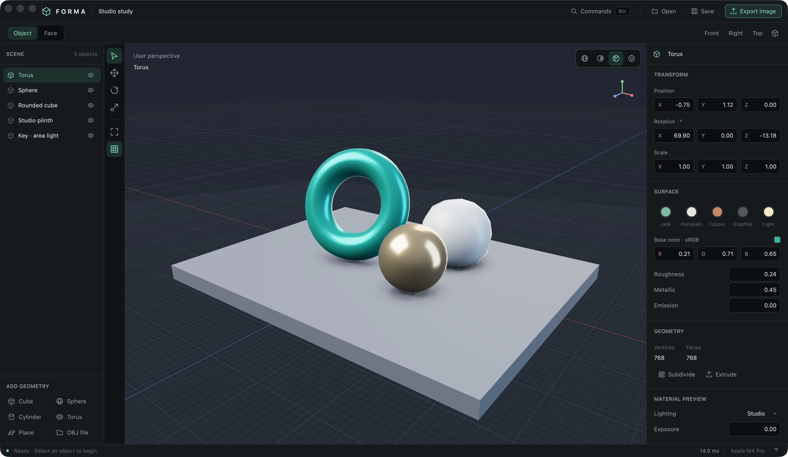
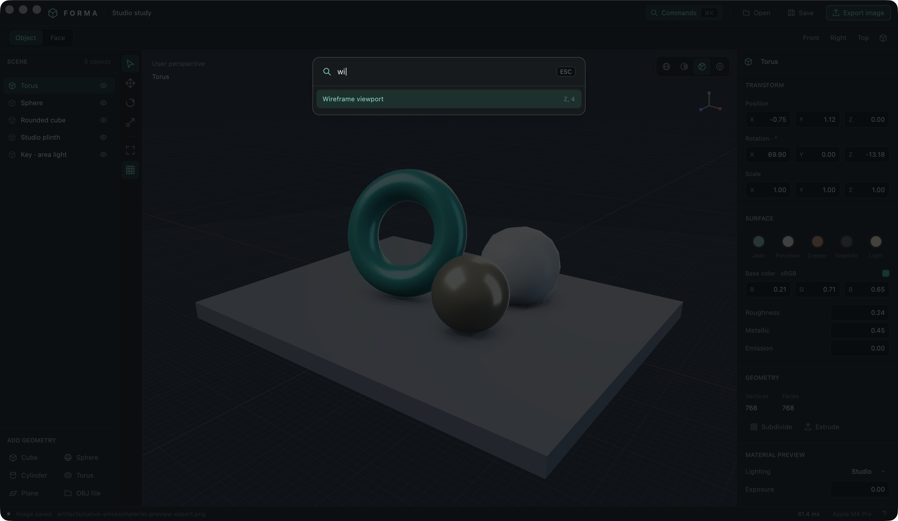
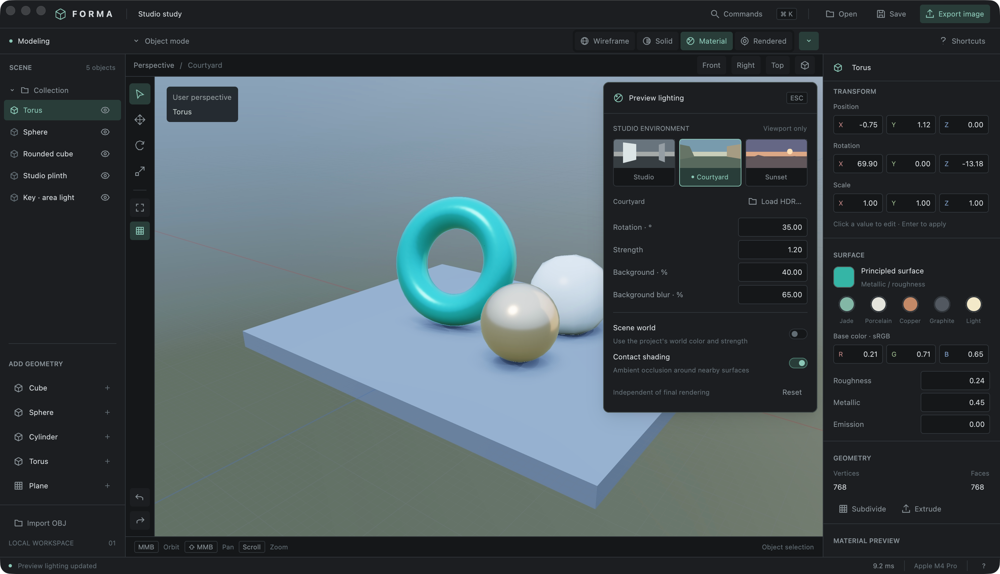

# Forma

A native Rust geometry editor built with GPUI, Metal, and wgpu. Forma combines a compact,
keyboard-driven workspace with direct mesh editing and a progressive path-traced
viewport on macOS, Windows, and Linux.

The application opens into a small studio scene: a teal torus, metallic sphere,
rounded cube, plinth and emissive area light.



## Downloads and releases

Get platform packages from [GitHub Releases](https://github.com/lachyfs/forma/releases).
Tagged releases include macOS Apple silicon/Intel, Windows x64, and Linux x86_64
packages with the AI denoiser and SHA-256 checksums. Packaged releases check for
authenticated updates in the background; choose **Updates → Restart to update**
when ready. Existing portable builds need one manual installation of a release
with the updater. See [automatic updates](docs/UPDATES.md) and
[releasing Forma](docs/RELEASING.md).


The standalone [download site](site/README.md) lives in `site/`. It can be served
by any static host without a build step and automatically discovers the latest
public GitHub release and available Mac downloads. The included
[GitHub Pages workflow](.github/workflows/pages.yml) deploys it from `main` after
selecting **GitHub Actions** as the source in the repository's Pages settings.

```sh
python3 -m http.server 4173 --directory site
```

## Run

Install Rust with [rustup](https://rust-lang.github.io/rustup/installation/index.html)
and the platform build dependencies below. The repository's `rust-toolchain.toml`
selects the compiler and lint tools used in CI. Then run:

```sh
python3 scripts/setup-denoiser.py  # Python 3.12+; installs the verified AI denoiser
cargo run --locked -p forma
```

| Platform | Default viewport renderer | Build requirements |
| --- | --- | --- |
| macOS | Native Metal, retaining direct CoreVideo display and accelerated preview | Apple Command Line Tools (`xcode-select --install`) and a Metal GPU |
| Windows | wgpu DirectX 12 | Rust MSVC toolchain, Visual Studio C++ Build Tools and Windows SDK, DirectX 12 GPU/driver |
| Linux | wgpu Vulkan | C/C++ toolchain, Clang, pkg-config, desktop development libraries, Vulkan GPU/driver; X11 or Wayland session |

On Ubuntu/Debian, install the Linux build dependencies with:

```sh
sudo apt-get install build-essential clang libclang-dev cmake pkg-config \
  libssl-dev libzstd-dev libasound2-dev libfontconfig1-dev libwayland-dev \
  libxkbcommon-dev libxkbcommon-x11-dev libx11-xcb-dev libvulkan-dev
```

The first build downloads and compiles dependencies. On macOS GPUI's
`runtime_shaders` feature compiles Metal source using the Command Line Tools.
On Windows GPUI's build also uses the Windows SDK shader compiler (`fxc`).

Backend selection is optional and does not change project files or tools:

```sh
cargo run --locked -p forma -- --renderer wgpu        # platform-native wgpu API
cargo run --locked -p forma -- --renderer native-metal # macOS existing renderer
cargo run --locked -p forma -- --renderer metal       # macOS through wgpu
cargo run --locked -p forma -- --renderer dx12        # Windows
cargo run --locked -p forma -- --renderer vulkan      # Linux or Windows
```

`FORMA_RENDERER` accepts the same values plus `auto`, and also applies to renderer
benchmarks and tests. `--renderer` overrides it in the app. Explicit unsupported
backends return an error instead of silently changing graphics APIs. The status
bar reports the active backend and device. See [platform support](docs/PLATFORMS.md)
for presentation differences and the validation matrix.

For an optimized executable:

```sh
cargo run --locked --release -p forma
```

## Current workflow

- Add cubes, spheres, cylinders, tori and planes; select objects in the viewport
  or outliner, duplicate, hide and delete them.
- Move, rotate and scale object groups and component selections with global/local axis and plane constraints,
  arithmetic and unit input, and viewport handles. Set exact local dimensions in the inspector;
  copy/paste numeric expressions and use `Tab` between fields. Show world dimensions and selected
  edge lengths with `Shift+M`.
- Apply object scale or rotation and scale, or center origins on geometry, from the Transform panel.
  Meshes and their descendants keep their world positions; other linked instances are preserved.
- Interactively extrude face regions or inset coplanar regions with exact thickness. Apply Catmull–Clark
  subdivision, or bevel every edge of a closed convex mesh with one segment. Triangulate selected
  faces or objects, reverse face winding, and recalculate consistent normals from the Geometry panel.
- Frame the selection or all visible geometry, and choose any of six orthographic views
  through the clickable axis gizmo, command panel or keyboard shortcuts.
- Choose PBR, Glass or Custom surface shaders, select PNG/JPEG image textures,
  and edit Metal/WGSL surface code with compile diagnostics. Adjust roughness, IOR, metallic response, emission,
  world strength and exposure. Enter arbitrary sRGB base colors and rename objects.
  Set the progressive sample and bounce limits, with AI denoising for the
  viewport and PNG renders. See [denoising controls and setup](docs/DENOISING.md).
- Save `.forma` projects with a versioned object graph, reusable mesh/material
  data, transforms, camera, world and render preferences. Version-1 projects
  migrate on open. Save replacement is atomic; edits support undo/redo.
- Import OBJ polygon geometry or ASCII/binary STL. Export transformed OBJ geometry, or choose
  units and a selected/visible scope for binary STL. Export the current render mode to PNG
  while continuing to edit.
- Personalize the editor with five color themes: Forma Dark, Paper, Midnight,
  Synthwave and Matcha. Open **Theme** in the title bar, **View → Color Theme…**,
  or search **Preferences: Color Theme** in the command panel. Type to filter,
  hover or use arrows to preview, then click or press Return to save your choice.
  Escape or clicking outside cancels. The theme is remembered across launches.
- Search commands with `⌘K`, type a name, then use arrows and Return to execute.
  Native menus and the command panel expose the same editor operations.
- Drag the divider between the viewport and the Scene Collection/inspector to
  adjust their widths. Double-click the divider to reset the sidebar width.
  Panel widths are kept for the session and do not change the project.

OBJ import combines groups into one object. Texture coordinates, supplied normals
and MTL materials are not retained; normals are generated from the editable
geometry. PNG export uses the current viewport dimensions and sample target,
with editor selection/grid overlays disabled.

STL exchange asks for **mm**, **cm**, **m** or **in** before opening the file picker;
STL files do not specify their own units. Import combines facets into one editable
mesh and shares vertices with identical coordinates. Export triangulates geometry,
applies world transforms and corrects winding for mirrored objects. Choose
**Selection** or **Visible scene**; hidden objects, including those hidden through
parents or collections, are excluded in either scope. Axes are preserved, with
Forma's **Y up** convention; there is no automatic conversion to Z up. STL carries
geometry without materials. Invalid imports leave the scene intact, and failed
exports preserve an existing destination file.

Open **Formats** beside **Export image** in the title bar to choose PNG, OBJ or
STL. At narrower window widths, Formats appears as a chevron. The direct
**Export image** button remains available for PNG export.

## Render modes

Press **Z** to open the shading pie at the cursor. Hold Z, move toward a mode,
and release to switch; tap Z to keep the menu open, then click or press its number.
Rendered sits above, Material Preview below, Wireframe left, and Solid right.
Arrow keys highlight a mode and Return selects it. Escape or right click cancels.

| Key | Mode | What it displays |
| --- | --- | --- |
| `Z`, then `4` | Wireframe | Blender-style X-ray original polygon edges (bright front, dimmed occluded); no triangulation diagonals. |
| `Z`, then `6` or directly `X` | Solid | Neutral clay shading with studio lighting. |
| `Z`, then `2` or directly `C` | Material Preview | Immediate metallic/roughness shading with HDR environment reflections and contact shading. |
| `Z`, then `8` or directly `V` | Rendered | Progressive lighting from the scene world and emissive meshes, with a selection outline over the viewport. |

All four modes show a thicker blue selection outline. It stays visible during
path tracing and denoising, without entering the rendered film or image exports.

The menu stays inside the viewport near its edges. Opening, hovering, cancelling,
or choosing the current mode preserves progressive accumulation. During a
transform, Z continues to constrain the world Z axis.



Material Preview displays a complete, deterministic frame without accumulating
path-tracing noise. The modelling modes use the display's backing pixel density
for sharp Retina rendering, within a proportional 2560 × 1600 resolution cap.
Camera updates and completed frames use event-driven delivery. Material Preview
uses Metal ray-tracing acceleration on the native macOS backend where supported, keeping full preview quality
during navigation.
Its lighting dropdown provides Studio, Courtyard and Sunset
environments, custom Radiance `.hdr` loading, rotation, intensity, background
visibility and blur. **Scene world** uses the project's world color and strength.
Otherwise preview lighting is independent of the scene world. Visible emission
remains part of the material; scene emitters do not light other objects in preview.
These preview controls are session settings and do not change the document or undo history.



Rendered mode traces full light paths. The renderer implements Lambert
diffuse, GGX reflection and rough dielectric glass transmission, direct emitter/environment sampling, multiple
importance sampling, Russian roulette, linear accumulation, exposure and an
ACES-style display curve. Native Metal display stays on the GPU through
IOSurface-backed CoreVideo NV12 buffers consumed by GPUI. wgpu computes the same
film on the selected GPU and hands immutable RGBA pixels to GPUI for display;
this path includes a readback and UI texture upload. PNG exports retain full RGB
chroma on every backend.

This is an initial surface renderer, with no claim of Blender or Cycles
feature parity. Volumes, subsurface scattering and adaptive sampling
are not implemented. Image textures use generated box, sphere or planar coordinates;
there is no UV editor. See [surface shaders and textures](docs/MATERIALS.md) for
custom code, image controls, glass behavior and limits. Rendered mode uses
Open Image Denoise for the viewport and PNG exports. HDR environment
imports currently support Radiance `.hdr` files for Material Preview. Animation,
sculpting, modifiers beyond destructive subdivision, UV editing and a full
vertex/edge modelling toolkit are outside the current application. See the
[renderer notes](crates/forma-render/README.md) for transport details and limits.

## Controls

The tables use macOS notation: on Windows/Linux use **Ctrl** in place of **⌘**
and **Alt** in place of **Option**. The viewport must have keyboard focus.
The in-app command panel opens with
`⌘K`, `Space` or `Shift+A`; `H` opens the shortcut reference.

| Action | Input |
| --- | --- |
| Select object / component | Left click; toolbar selects Object, Face, Edge, or Vertex; `Tab` toggles Object and the last component mode |
| Extend selection | `Shift` + click; works on objects and mesh components |
| All / none / invert / linked | `A` / `Alt+A` / `⌘I` / `L` (linked selects connected mesh components) |
| Box selection | `B`, then drag; `Shift` adds and `Ctrl` subtracts |
| Vertex / edge / face mode | `1` / `2` / `3` while editing components |
| Orbit | Two-finger trackpad drag, middle/right drag, `Option` + left drag, or `Option` + wheel |
| Pan | `Shift` + two-finger drag, `Shift` + middle/right drag, or `Shift` + wheel |
| Zoom | Pinch, mouse wheel, `Ctrl` + middle drag, or `Ctrl` / `⌘` + two-finger drag |
| Focus selection | Backtick (`` ` ``), `.` / numpad decimal, or `F`; focuses the entire selection |
| Frame all visible geometry | `Home` |
| Shading pie | `Z`; hold and flick, or tap then select |
| Move / rotate / scale | `G` / `R` / `S` |
| Constrain transform | `X`, `Y` or `Z`; repeat the same key for global → local → free |
| Plane constraint | `Shift+X`, `Shift+Y` or `Shift+Z` excludes that axis |
| Snap transform | Hold `Ctrl`; combine with `Shift` for finer increments |
| Enter an exact transform | Arithmetic such as `(2+3)/4`; distances accept `m`, `cm`, `mm`, `in`, `ft`; angles accept `deg` or `rad`; scale is unitless |
| Select / copy / paste numeric text | `⌘A` / `⌘C` / `⌘V` while editing an inspector field or transform expression |
| Next / previous inspector field | `Tab` / `Shift+Tab`; commits valid input and stays within the current inspector section |
| Apply / cancel transform | Click or `Return` / `Esc` or right click |
| Fine pointer movement | Hold `Shift` during a transform |
| Extrude / inset region | `E` / `I`, move the pointer or type a distance, then confirm |
| Bevel all edges | `⌘B` in Object mode; enter a width, then confirm; requires a closed convex mesh |
| Triangulate / flip / recalculate normals | Geometry panel or command panel; triangulate and flip use the selected face region or objects |
| Apply scale / rotation and scale / center origin | Transform panel or command panel, in Object mode |
| Selection measurements | `Shift+M`; world dimensions and selected edge lengths in metres |
| Duplicate / delete | `⌘D` or `Shift+D` / `Delete` or `Backspace` |
| Front / right / top | `1` / `3` / `7` in Object mode (also available in the command panel) |
| Back / left / bottom | `Option+1` / `Option+3` / `Option+7` |
| Axis view gizmo | Click `±X`, `±Y` or `±Z`; click the facing handle again to see the opposite side |
| Toggle projection / reset perspective | `5` / `0` |
| Undo / redo | `⌘Z` / `⌘Shift+Z` |
| Color theme picker | `⌘Shift+T` |
| New / open / save / save as | `⌘N` / `⌘O` / `⌘S` / `⌘Shift+S` |

Component edit modes show visible polygon edges on every mesh; Vertex mode also shows vertex markers. G/R/S transforms the selection around its median center. Rotation follows the pointer around the pivot; scaling follows pointer distance. Holding or releasing Shift preserves the current transform. Delete removes a face, or an edge/vertex and its incident faces; deleting the last face requires Object mode. Editing overlays are excluded from exported images.

Extrude creates shared cap vertices and boundary walls for the selected region. Inset supports coplanar regions and keeps thickness even under object scaling. Duplicate starts a move operation immediately. Confirming creates one undo step; Escape restores the geometry and selection from before the operation. Invalid geometry or unfinished numeric input stays uncommitted.

Distance input defaults to metres: `25mm`, `1/8in`, `(2+3)*10cm` and `1ft+6in`
are supported in movement, mesh-tool widths and inspector distances. Rotation defaults
to degrees and also accepts explicit radians. Invalid expressions remain editable.
Inspector edits open with the full numeric value, independent of the rounded
display label. Copy retains the complete active expression; paste replaces selected
text or appends at the end. Unsupported or multiline paste leaves the existing
input intact. `Tab` and `Shift+Tab` move through the current inspector group,
skipping hidden controls; invalid input keeps its field active for correction.

Inspector **Dimensions · m (local)** measures the mesh along its local axes after its
own scale, excluding rotation and parent transforms; changing a dimension adjusts
that scale axis and preserves mirroring. Flat axes require geometry before they can
be given thickness. **World dimensions** measures the visible selection's bounding
box along world axes, including rotation and hierarchy. Edge mode also shows the
total selected edge length and up to 12 individual labels. Measurement overlays
are session controls and never appear in exported images.

In Object mode, **Apply scale** bakes local scale into selected meshes and resets
their scale to one. **Apply rot / scale** also bakes rotation and resets it to zero.
**Origin to geometry center** moves each origin to its mesh's local bounding-box
center. These commands preserve world geometry, material links and descendant
transforms. Edited objects receive independent mesh data when needed to protect
other linked instances; unchanged objects keep their existing links. Each command
is one undoable transaction, including when both a parent and its child are selected.

Bevel is a destructive, single-segment chamfer of every edge on the active Object-mode
mesh. Its width is measured along adjacent faces in world space. Open, concave,
warped or collapsed inputs are rejected; there is no selected-edge bevel or rounded
multi-segment bevel. Triangulation preserves polygon winding. Recalculate normals
orients the whole mesh consistently and makes closed shells point outward; open
surfaces retain their starting side because they have no intrinsic outside.

An unconstrained numeric move uses world X. Rotation without an axis constraint
uses the viewing axis. Subdivision, imports, exports, primitives and material
presets are also available through the visible panels and command panel.

## Verify

Pull requests run formatting, workflow/script linting, website tests, a Rust
dependency audit, and builds/tests on Linux, Windows, and macOS. Linux also
executes the renderer through Mesa software Vulkan and saves smoke images as
workflow artifacts. See [CI and local checks](docs/CI.md) for details, tool
updates, and the status checks to require before merging.

```sh
cargo fmt --all -- --check
cargo test --locked --workspace
cargo clippy --locked --workspace --all-targets -- -D warnings
cargo run --locked -p forma -- --smoke-test artifacts/native-smoke

# Render all four modes through the selected GPU backend, without opening a window.
cargo run --locked -p forma-render --bin render-smoke -- artifacts/render 128
```

The native smoke test opens its own GPUI window without taking keyboard focus.
It exercises keyboard dispatch, continuous pointer-handler input, real GPU
frames, modelling commands, background document operations, and concurrent PNG
export. On macOS it captures its own window; other platforms export viewport images
from the smoke workflow. Native file-picker
interaction and OS pointer routing remain manual checks.

Core geometry tests can run independently with `cargo test --locked -p forma-core`.
For CPU-only triangulation and validation timings, run
`cargo run --locked --release -p forma-core --bin mesh-bench`. It reports median
and p95 latency for 65,536-face triangle, quad and concave-polygon meshes without
requiring a GPU or window system.
Additional CPU benchmarks cover picking, visibility queries and renderer geometry
preparation, including the bundled V8 scene and synthetic stress cases:

```sh
cargo run --locked --release -p forma-core --bin picking-bench
cargo run --locked --release -p forma-core --bin surface-query-bench
cargo test --locked --release -p forma-render --lib geometry_preparation_benchmark -- --ignored --nocapture
```

These report timings without device-specific pass/fail thresholds. The geometry
preparation benchmark compares the retained reference implementation with the
current implementation and checks exact output equality before timing.
Renderer integration tests require a compatible GPU (Mesa software Vulkan can
also execute them in CI). The [validation record](docs/VALIDATION.md) separates executed numerical, image and
application checks from unverified scale or performance claims.

## Bundle

```sh
# Linux portable directory and tar.gz:
./scripts/bundle-linux.sh release

# Windows PowerShell portable directory and zip:
./scripts/bundle-windows.ps1 -Profile release

# macOS:
./scripts/bundle-macos.sh release
open target/release/Forma.app

# Faster iteration using the development profile:
./scripts/bundle-macos.sh debug
```

The macOS script creates `Forma.app`; Linux and Windows scripts create portable
directories and archives under `target/<profile>/`. They package the host
architecture; macOS receives an ad-hoc signature. These local bundles do not
include automatic updates. The release workflow wraps them with Velopack and
signs update metadata. Release builds use thin
LTO and may take longer than development builds.

See [architecture](docs/ARCHITECTURE.md) for crate boundaries, frame ownership,
render invalidation and document transactions.
