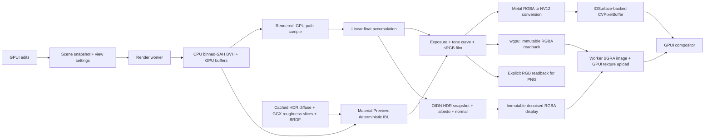

# Architecture

Forma's main crates are below. Scene data is independent of UI, GPU resources
and the CAD kernel; the native app owns interaction and coordinates the renderer
and the CAD kernel through workers.

| Crate | Responsibility |
| --- | --- |
| `forma-core` | Indexed polygon meshes, primitives, subdivision/extrusion/inset, convex bevels, triangulation and normal orientation, materials, object transform/origin utilities, camera, picking, history and scene/OBJ/STL I/O. |
| `forma-cad` | B-rep CAD on the [truck](https://github.com/ricosjp/truck) kernel: part regeneration from feature histories, robust booleans, tessellation into grouped Forma meshes, part ↔ mesh conversion, STEP I/O, and the crash-isolated worker process and host. |
| `forma-render` | Native Metal and wgpu compute pipelines, shared triangle/BVH upload and light transport, progressive film, immutable display frames and PNG readback. |
| `forma` (`crates/forma-app`) | GPUI workspace, commands, inspector, outliner, face/object transforms, native dialogs, viewport overlays and render scheduling. |

## Scene and geometry

Coordinates are right handed with +Y up. Editable meshes retain polygon faces;
ear clipping produces triangles for rendering and picking. Original polygon
edges remain distinguishable from triangulation diagonals. Primitive winding is
outward. Subdivision uses Catmull–Clark interior and open-boundary rules; extrusion
replaces its source cap and connects the boundary with side faces.

Mesh finishing operations are transactional. Explicit triangulation returns the
new face selection; winding reversal preserves face indices. Normal recalculation
propagates orientation across shared edges and uses signed volume to orient closed
components outward; open components retain the side of their first face. Bevel
builds inset faces, edge strips and corner caps for closed convex components with
one segment. It rejects unsupported topology, nonplanar or concave geometry and
collapsed widths, with a bounded convexity check. The app transforms the active
mesh to world space for bevel previews so widths account for object and parent
scale, then restores local coordinates. These are destructive mesh operations.

The scene model separates **objects** from reusable **data blocks**. An object
owns identity, name, local transform, parent, visibility, selectability,
collection links and a typed payload. Mesh payloads reference named mesh and
material data by stable IDs, so multiple objects can instance the same data.
Normal duplication makes independent mesh/material copies; linked duplication
shares them, and either link can later be made single-user. Mesh instances are
the resolved boundary used by render, picking, OBJ/STL exchange and editor code, keeping
those consumers independent of storage layout and non-mesh object types.

Object payloads currently model mesh, empty, light and camera objects, plus a
namespaced custom type with JSON properties for forward-compatible extensions.
Collections form a visibility hierarchy, objects may belong to multiple
collections, and object parent chains compose local transforms into world
transforms. A parent-inverse matrix preserves an object's exact world transform
when it is parented under rotated, nonuniformly scaled geometry. Parent and
collection cycles, dangling references and global ID collisions are rejected by
validation. Data blocks may intentionally outlive their users and can be removed
explicitly with orphan purging, matching the useful parts of Blender's
object/data distinction.

Object transform utilities operate on a staged scene and commit only after all
selected meshes and resulting transforms validate. Apply Scale bakes local scale
into vertices and resets it to one; Apply Rotation and Scale also resets rotation.
Center Origin uses the local mesh bounding-box center. Each operation factors a
coordinate change into the mesh and compensates direct children's parent-inverse
matrices, preserving world geometry throughout the descendant hierarchy without
decomposing shear. Reflected bakes reverse polygon winding. Only edited objects
whose mesh data is shared receive independent mesh data; unedited instances and
material links remain intact, and no-ops allocate no IDs. The app exposes these
commands in Object mode and records one history entry for a changed selection.

Transforms are translation, XYZ Euler rotation in radians and scale. The
viewport camera supports perspective and orthographic projection with the shared
0–1 depth range. Its analytic yaw/pitch basis remains defined at exact
top/bottom views. Picking transforms rays into each object's local coordinates
while preserving world-space hit distances under hierarchy and nonuniform
scaling. A conservative mesh-local bounds test skips triangulation for missed
objects. Bounds are recomputed from the publicly mutable mesh, with a fallback
to triangle testing when loose vertices make the bounds scan more expensive.
The six axis-gizmo handles dispatch the same orthographic view commands as the
command panel and opposite-view shortcuts (`Alt+1/3/7`). Repeating a facing handle reverses
the view when the opposite handle is hidden behind it. Frame All (`Home`) uses
the world bounds of effectively visible mesh instances.

Component picking, box selection and overlays share a lazily built world-space
`SurfaceQuery`. The editor clears it through geometry invalidation, including
visibility changes and undo/redo; camera navigation and selection reuse it.
The query packs leaf ranges and child links into one node variant and tests all
three box axes together, retaining division and the original traversal order.

Materials contain linear RGB base color and emission, metallic weight,
roughness, IOR, a PBR/Glass/Custom shader selection, generated texture coordinates,
five immutable embedded image slots and a custom Metal/WGSL surface function body with its language. The renderer computes smooth corner normals with a 45-degree crease
threshold and transforms them correctly under nonuniform scale. Image mip levels and material buffers feed a common surface evaluator in Preview
and Rendered. Custom code compiles on a background executor before an editor
transaction commits; the renderer caches both entry-point pipelines by source.
Invalid project code uses a reported PBR fallback. There is no node graph.
See [material contracts and limits](MATERIALS.md).

## CAD parts

A **part** is an object whose payload is `ObjectData::Part { part, mesh,
materials }`. `part` names a `PartData` block in `Scene::parts`: an ordered,
editable feature history with stable feature ids, per-feature suppression and a
rollback marker. Features are a serde-tagged enum of plain parameter structs —
`Primitive` (box, cylinder, sphere, cone, torus with a placement), `Extrude` and
`Revolve` (each embedding the sketch it consumes, region picks as interior
points, and a Join/Cut/Intersect/New body operation), `Combine` (tool bodies with
their own nested histories and a part-space transform), `PushPull` (a persistent
`FaceRef`), `Chamfer` (`EdgeRef`s) and `BaseBody` (a converted mesh or an
embedded STEP document). A feature can record the object it came from in
`source`. No kernel types appear in `forma-core`.

Kernel face and edge ids do not survive edits, so references are geometric:
a `FaceRef` is a point on the face and its outward normal, resolved at
regeneration to the face with a matching normal that lies nearest in its own
plane (offsets along the normal weigh less, so a face moved by an earlier
feature is still found). `forma_cad::face_ref_from_pick` builds one from a
viewport pick on the cached tessellation without the kernel. `EdgeRef`s are
straight-edge end points.

`mesh` is the cached tessellation of the last regeneration: an ordinary
`MeshData` block, so rendering, picking, measurements and OBJ/STL export use
parts through `MeshInstance` unchanged. Polygon tools never reach it:
`Scene::object_mesh_mut` returns `None` for parts, transform baking refuses them,
and the editor answers component commands with “Convert to mesh to edit
polygons”. `PartData::stamp` is an FNV-1a hash of the canonical JSON of the
features, rollback marker and tessellation quality; `evaluated` records which
stamp produced the cache and the feature issues it reported. Editing helpers
restamp; loading recomputes every stamp, so a hand-edited file can never pass
off a stale cache. Undo restores whole scenes including caches, and the stamp
check requests regeneration when needed.

### Kernel layer (`forma-cad`)

truck is pinned to its crates.io releases (`truck-modeling`/`-topology`/
`-polymesh` 0.6.0, `-shapeops` 0.4.0, `-meshalgo` 0.4.0 vendored without its
`vtk` default, `-stepio` 0.3.0). It works in cgmath `f64`; conversion to glam
happens at the crate boundary. Features evaluate in order against the body
built so far. A failing feature becomes a `FeatureIssue` (which feature, why,
what to try) and is skipped, so the rest of the history still regenerates.
Bodies after each feature are memoized per part by a hash chain over the
feature prefix (names excluded), so editing the last feature re-evaluates only
that feature.

Sketch regions come from `Sketch::profiles`, the planar arrangement. Features
pick regions by interior points (each point selects the region containing it);
no picks means the outermost regions with their holes. Adjacent picks are
merged in 2D (shared boundary pieces cancel) so they extrude as one solid.
Hole winding is normalized before `try_attach_plane`, faces are oriented
before sweeping, profiles touching a revolve axis use `builder::cone` so poles
close without degenerate faces, and every new solid is oriented outward by its
tessellated volume.

truck's booleans need a guard layer, measured during the dependency audit:

- **Tolerance** for intersection tracing scales with part size and the
  smallest construction radius, clamped above truck's hard 1e-6 limit.
- **Bounding boxes** short-circuit disjoint operands (truck returns an empty
  subtraction for them). Nested operands are classified from meshes first —
  a tool strictly inside becomes a void, an enclosing tool is a clear error —
  because truck panics or silently returns an operand unchanged there.
- **Retries**: a finer tracing tolerance, then the tool inflated by a tiny
  overshoot about its centre so coplanar or flush faces separate.
- **Validation** of every result: closed shells, plausible volume, probe
  points just inside the tool (they must leave a cut and stay in a join), and
  per-face checks that material lies behind each face and not in front (truck
  can keep a zero-thickness lid over a flush-capped hole).
- **Lumps**: tools with several separate lumps are applied one at a time.
- **Transforms** of boolean results can loop forever in truck, so
  intersection curves are baked first on a deep copy: straight and circular
  ones become exact lines and arcs, others sampled B-splines.
- All kernel calls run under `catch_unwind`; aborts and hangs are handled by
  the worker process below. `is_geometric_consistent` is never called (it can
  overflow the stack on revolved surfaces).

Push/pull tries, in order: the polyhedral path (every face planar, every edge
straight: the face's vertices move to the nearest point on the moved plane and
their other incident planes, rejecting collapses), the prism path (bodies that
are extrusions along the face normal, such as drilled plates, re-extruded from
their base face), and finally an overlapping join or cut with the extruded
face. Chamfers subtract a triangular wedge whose sides overshoot outside the
body so no face is coplanar with an existing one; they support straight convex
edges between planar faces that end at convex corners.

Meshes become parts through `BaseBody::Mesh`: closed, consistently oriented
manifold meshes only (`check_closed_manifold` explains failures before any
kernel work). Coplanar neighbouring polygons merge into one B-rep face, possibly
with holes; non-planar polygons are triangulated; vertices are snapped onto all
incident face planes so faces are exactly planar for truck. Parts become meshes
by baking: hole-free planar faces become single n-gons, curved faces stay
triangles, and vertices are welded so polygon tools see one connected surface.

STEP export bakes intersection curves (truck-stepio 0.3 writes raw boolean
results that do not read back), converts metres to truck's millimetres, applies
object world transforms and writes a fixed header timestamp, so output is
deterministic. Import detects the length unit, keeps the document as a
`BaseBody::Step` and regenerates from it; imported geometry renders and exports
but cannot take part in booleans yet.

### Tessellation and display

Each B-rep face is tessellated with a chord tolerance relative to the part's
size, tightened by its smallest construction radius so a facet turns at most
6–22° depending on `TessellationQuality`, within a 1.5 million triangle budget.
Faces keep separate vertices, so the renderer's normal smoothing (which averages
over shared vertices) gives crisp creases between B-rep faces and smooth shading
within curved ones. Neighbouring faces whose exact surface normals agree within
about 2° along their shared edge — such as the patches truck uses for a
cylinder side — share a face group and welded vertices, hiding the seam.

`Mesh::groups` (optional, one entry per polygon, omitted from older files)
carries the face group. Picking a polygon resolves to its group;
`RegenResult::faces` describes each group (planar or curved, B-rep face indices,
a point and normal, area). `Mesh::display_edges` omits edges shared only by
polygons of one group; the renderer uses the same rule for `edge_bits`, so
Wireframe, edit overlays and selection highlights show B-rep edges, never
tessellation diagonals. Ungrouped meshes keep exactly their previous edges, and
the geometry-preparation oracle checks both.

### Worker process

Kernel calls can panic, abort the process (stack overflow) or loop forever, so
the editor never runs them in-process. `CadHost` (in `forma-cad`) owns a
`forma --cad-worker` child process — the same executable, branching before the
updater or any window starts — and talks to it with length-prefixed JSON frames
behind an 8-byte magic, so stray text a dependency prints on stdout is skipped.
One request runs at a time on the host thread; queued regenerations of the same
part are coalesced. The worker reports progress before each feature. If no
progress arrives within the per-feature timeout (20 s) or the request exceeds
120 s, or the worker exits, the host kills it, reports the restart, and retries
the regeneration with the last reported feature marked as skipped (up to three
times), so the rest of the part still appears with a clear issue. The worker's
own stdin reader exits the process as soon as the editor's pipe closes, even
mid-computation, and `Studio::shutdown_cad` kills it from the app-quit hook.
`WorkerMode::InProcess` runs the same request handler without isolation for
tests.

In the editor (`crates/forma-app/src/cad.rs`), every geometry invalidation calls
`sync_parts`, which submits each part whose cache is stale and not already
requested. Results arrive through an async channel and are installed with
`Scene::set_part_tessellation`, which drops stale stamps. Nothing waits on the
UI thread; the status line reports regeneration results and issues, and the
inspector's Part section lists features with their state.

## Interaction and scheduling

`Studio` owns the mutable `Scene`, current selection, command/field state and
document history. A drag starts from an immutable original object and applies
pointer or typed deltas against that original, avoiding incremental numerical
drift. Commit validates the edited scene and creates one undo checkpoint;
cancellation restores the original object.

The pure numeric parser carries distance and angle dimensions through arithmetic,
supports parentheses and scientific notation, and rejects incompatible units or
non-finite results. Distances use metres (`m`, `cm`, `mm`, `in`, `ft`); angles default
to degrees and accept `deg` or `rad`; scale stays unitless. A sole trailing unit
can qualify a whole scalar expression, including `1/8in`. Invalid inspector
input remains active; changed values produce one undo checkpoint. Modal previews
retain their immutable starting scene and cannot commit unfinished expressions.

Inspector field edit text uses the full numeric value rather than the rounded
display string. The shared single-line entry helper handles clipboard insertion,
whole-text selection and deletion for both fields and modal expressions. Copy
preserves the active expression; paste validates every character and the 128-byte
budget before replacing or appending text, so rejected input changes nothing.
`Tab` commits a valid inspector edit and advances within its transform, surface,
render or preview group; `Shift+Tab` reverses direction. Navigation skips controls
hidden by shader, texture or viewport state, scrolls the next field into view and
stops on invalid input. These keys retain their ordinary editor commands outside
text entry.

Inspector dimensions use the mesh's local bounding box multiplied by absolute
object scale, excluding rotation and parent transforms. Setting one dimension
preserves the sign of that scale axis and rejects flat or unsupported extents.
A cache keyed by selected object stores the dimension vector until geometry
invalidation. World measurements (`Shift+M`) instead use exact transformed
selection bounds and selected world edge lengths. Their separate cache is keyed
by object/component selection and edit mode and cleared by geometry invalidation;
camera updates and progressive frame presentation reuse it. The GPUI overlay
draws guides and up to 12 edge labels while summing all selected edges. It is
independent of the render film, export output, document and undo history.

GPUI submits pending changes at the end of the current input/effect cycle.
Geometry edits refresh a shared `Arc<Scene>` snapshot; camera/world updates reuse
the geometry snapshot. The render worker has one pending request slot: new input
replaces obsolete pending work instead of building an unbounded queue. Completed
frames wake GPUI through a bounded async notification channel. Layout and display
scale changes trigger resizing directly. There is no periodic polling delay or
idle render timer. The event loop does not wait for GPU completion and can present
the most recently completed surface while a newer request is rendering.

A separate denoising worker owns a persistent OIDN device and a bounded latest-snapshot
mailbox. Generation guards reject stale clean frames; completion wakes GPUI even
when the path tracer has reached its sample cap. Denoised display uses immutable
RGBA images on all platforms.

The worker owns its `Renderer` and renders one sample per call. Static modes stop
after one frame, including Material Preview; Rendered continues to the sample cap and
then sleep until another request arrives. PNG export uses a separate renderer
and immutable scene snapshot, so export does not replace the interactive film.
Export still shares the physical GPU and can reduce viewport throughput.

## Editor appearance

The workspace chrome lives in `crates/forma-app/src/ui/`. `tokens` holds the
spacing, radius, control-height, type and motion scales; `assets` embeds the
Lucide-based SVG icons and the Inter font; `components` builds every control from
those tokens. Shell regions (`titlebar`, `hud`, `outliner`, `inspector`,
`statusbar`) and `overlays` compose components and never use literal colors.
`modes` lists the title bar's workspace modes as data, and `slots` provides the
reserved viewport dock and adjust-last-operation hooks that features fill.

The app's `theme` module defines semantic color tokens (surfaces, lines, ink tiers,
accent, status and axis colors) and five built-in presets that map onto them.
The theme picker previews a candidate without changing the saved choice. Escape,
clicking outside, or opening another editor command discards the preview; click or
Return commits it. Theme changes notify GPUI without invalidating the renderer or
mutating the scene, dirty state, or undo history. Axis identities and material
swatches retain their scene meaning across themes.

The selected stable theme ID is saved atomically to `forma/color-theme` beneath
macOS's `~/Library/Application Support`, Windows's `%APPDATA%`, or Linux's
`$XDG_CONFIG_HOME` (falling back to `~/.config`). Missing or unknown IDs use Forma
Dark. I/O failures retain the usable session theme and report through the status
bar. Native smoke tests use a preference file inside their output directory.

## GPU pipeline and surface ownership

A public `Renderer` selects native Metal on macOS by default, or wgpu using
Metal, DirectX 12 or Vulkan. The application passes its selected backend to both
the viewport worker and independent export workers. `RenderSettings`, geometry
fingerprints, uniforms, BVH construction, bounded HDR decoding and built-in HDR
rigs are shared across implementations. WGSL ports preserve the Metal shader
algorithms; shader tests validate layouts and translate all kernels to native
SPIR-V, MSL and HLSL.

GPU geometry buffers and accumulation persist across samples. A scene revision
causes validation and a geometry fingerprint check; unchanged geometry avoids
BVH rebuild and upload. During a rebuild, linked mesh instances share mesh-space
triangulation, generated coordinates, crease normals and polygon-edge flags.
Incident triangle corners use contiguous storage. Transforms and materials are
applied per object; shared preparation is released before building the BVH.
Native Metal Material Preview uses a cached primitive acceleration
structure on devices supporting Metal ray tracing, and software BVH traversal on
other devices and all wgpu backends. Its primary, antialiasing, nearest-hit contact AO and selection
rays keep the same sampling and lighting calculations. The structure references
the world-space triangle buffer with explicit vertex indices, preserving material
and object IDs; it is built lazily and reused throughout camera navigation.
Rendered retains its existing software traversal and estimator. Film identity includes camera, dimensions, world and
render settings. A lighting or view change resets accumulation. Raising the
sample target resumes the existing film. Selection/grid state affects only the
modes which display those overlays. A frame at its sample cap is reused. Material
Preview has a separate cache identity that ignores path-tracing targets and
unused scene-world settings. Preview-only lighting never resets Rendered.

Preview uses cached HDR textures for diffuse irradiance and filtered specular
reflections, with a split-sum BRDF lookup and bounded contact AO. Environment
baking happens on the render worker only when a new light is selected. Custom
HDR files are validated on a background executor before applying them; request
identity guards reject stale completions after selecting another environment.

For native Metal, GPUI 0.2.2's macOS surface compositor requires bi-planar NV12. Forma therefore
converts its RGB film to full-range BT.601 NV12 on the GPU and obtains output
planes from a CoreVideo pixel-buffer pool. Normal display performs no CPU pixel
copy. PNG export reads the RGB film, avoiding display chroma subsampling.

wgpu copies each completed display film into an aligned reusable staging buffer
and publishes tightly packed immutable RGBA pixels. The worker prepares BGRA
pixels for GPUI's image API, and the UI removes previous image allocations from
its texture atlas when adopting a newer frame. There is a readback and upload per
frame; rendering and conversion remain off the UI event loop. A retained portable
frame owns its pixels even after resize or renderer destruction.

A published native `Frame` retains an immutable pixel buffer. The renderer completes
GPU writes before publishing it and never overwrites a retained surface. Metal
texture wrappers stay alive until their command completes. CoreVideo can recycle
storage only after all consumers release it. These rules justify sending a
completed frame between the worker and GPUI threads.

Detailed BSDF, estimator, BVH and display behavior lives in the
[renderer documentation](../crates/forma-render/README.md).

## Documents and undo

The `.forma` format is versioned JSON with `format`, `version` and `scene` fields.
Version 4 adds CAD part data blocks (`parts`) and part objects; version-3 files
migrate by gaining an empty part list, and files from a newer Forma are refused
with a clear message. Version 3 stores shader settings, custom code and embedded texture images alongside
the object graph, reusable mesh/material data blocks,
collections, typed object payloads, camera, world and render preferences.
Version-1 files are migrated on load into independent mesh/material data blocks;
version-1 and version-2 materials receive PBR defaults and empty image slots;
older files without render preferences receive defaults. Selection, active
tool, viewport shading mode and preview environment controls are session state.

Load checks finite values, camera/material ranges, unique IDs, polygon indices,
triangulability and aggregate geometry limits before replacing the current scene.
Save validates first, writes and syncs a temporary file beside the destination,
then renames it atomically. A failed write leaves the previous document intact.
The app asks before discarding a dirty document on new/open/close.

History stores up to 64 whole-scene checkpoints and trims older snapshots using
an estimated 256 MiB geometry budget. Shared mesh data is counted once per scene
rather than once per object instance. At least one transaction is retained even
if its single scene exceeds that budget. A new edit clears the redo branch. This
is a straightforward initial transaction model; large-scene editing would
benefit from operation-level history and copy-on-write data blocks.

OBJ is a geometry interchange path, not a project format. Import handles polygon
faces, positive/negative indices, common `v/vt/vn` syntax and line continuations;
groups become one editable object. Supplied UVs, normals and MTL data are not
retained. Export bakes object transforms and reverses winding for reflections.

STL is a unitless triangle exchange path. The app asks for millimetres,
centimetres, metres or inches before import/export; core APIs take an explicit
positive finite metres-per-unit factor. Import multiplies file coordinates by
that factor, and export divides world coordinates by it. Neither direction
remaps axes: Forma's right-handed +Y-up coordinates are preserved. Materials and
vendor color attributes are omitted. Supplied facet normals are checked for
finite values but geometry winding determines editable normals.

The STL reader supports binary and ASCII, including multiple ASCII solids and
LF, CRLF or CR line endings. Exact binary record length and count take precedence
over a `solid` header. The reader rejects truncated records, trailing binary
data, malformed facets and degenerate or out-of-range converted geometry. Exact
coordinate deduplication canonicalizes signed zero without proximity welding.
File reads are bounded at 256 MiB; a mesh allows at most two million vertices and
triangles. OBJ and STL share import capacity checks for objects, meshes,
materials, aggregate geometry and reserved IDs before insertion.

Binary STL export triangulates polygons with the existing ear clipper, includes
each instance's world transform, reverses reflected winding and recomputes facet
normals from the encoded vertices. The optional object selection intersects
effective object, parent and collection visibility; locked visible objects remain
exportable. The writer counts every instance before allocating output, rejects
more than two million triangles and checks coordinate overflow or collapsed
triangles after conversion to STL floats. Empty scopes fail without touching the
destination. A same-directory temporary file and atomic rename protect existing
exports. Import and export run on background executors with the document/snapshot
guards used by the other exchange paths.

## Current performance boundaries

Wireframe, Solid and Material Preview render at the window's backing pixel density,
including 2× Retina displays. Oversized viewports scale uniformly into a
2560 × 1600 budget before even-dimension NV12 alignment, keeping their aspect
ratio within rounding precision. Moving between displays updates the backing scale.
Rendered retains one render pixel per logical point for its path-tracing budget.
The public renderer permits up to 8192 × 8192; the UI currently exports at the
active mode's viewport resolution. Core document limits protect
resource use but are not tested interactive-performance guarantees.

Wireframe and Rendered use software BVH traversal; Solid and Material Preview can
share native Metal ray-tracing acceleration structures. Opaque preview scenes
use a specialized pipeline without glass continuation state. wgpu modes use the shared
software BVH on the GPU. Geometry validation, triangulation, BVH construction,
OBJ/STL I/O and history cloning remain CPU work. Project/OBJ/STL parsing and disk writes
run on background executors. Snapshot cloning, picking, subdivision and transform
validation still run on the UI thread and can pause on large meshes. Generation
and document-identity guards reject stale loads and preserve edits made during
an asynchronous save. Material Preview produces deterministic IBL shading in one
frame; its reflections use the environment and contact shading approximates
occlusion. Rendered has optional Open Image Denoise reconstruction for the viewport
and exports; its original Monte Carlo film continues accumulating independently.
Adaptive sampling is not implemented. See [AI denoising](DENOISING.md) for the
three-pass HDR pipeline, asynchronous scheduling and runtime distribution.

The [validation record](VALIDATION.md) documents the tests and local measurements
actually executed. Future performance work can replace GPU traversal or history
storage behind these crate boundaries without changing scene serialization.
